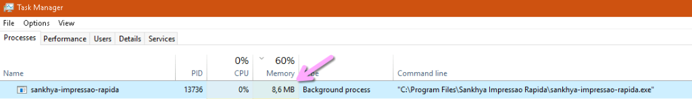
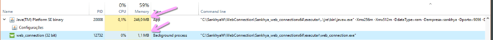
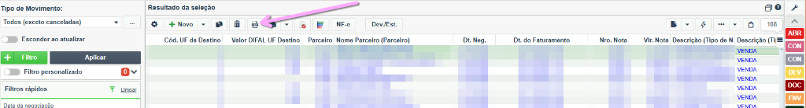

# ⚡ Sankhya Impressão Rápida — Alternativa Leve ao Sankhya Web Connection

> **Substituto ultra-leve, de alta performance e código aberto para o Sankhya Web Connection no ERP Sankhya W e Sankhya Om.**

---

### ⚠️ Aviso Legal e Isenção de Responsabilidade (Disclaimer)
> Este projeto é uma iniciativa independente e de código aberto da comunidade, **não sendo afiliado, endossado, mantido ou desenvolvido pela Sankhya Gestão de Negócios Ltda.**
> 
> O software original e oficial **Sankhya Web Connection** é de propriedade e autoria da Sankhya Gestão de Negócios Ltda., **funciona perfeitamente** e pode ser obtido oficialmente no portal [downloads.sankhya.com.br](https://downloads.sankhya.com.br).
> 
> A finalidade desta implementação alternativa em Rust é puramente técnica: fornecer uma opção nativa e ultra-leve voltada para **eliminar o consumo excessivo de hardware e memória RAM** em computadores e servidores com recursos limitados de processamento.

---

## 🎯 Por que este projeto existe?
Com o encerramento do antigo Navegador Sankhya e a migração oficial do **Sankhya W / Om** para navegadores modernos como o **Google Chrome** e **Microsoft Edge**, o uso de impressões locais (térmicas, cupom fiscal, impressoras de rede Zebra, Brother e relatórios) tornou-se dependente do aplicativo local *Web Connection*.

No entanto, a implementação baseada em Java mantém uma máquina virtual Java inteira aberta o tempo todo consumindo frequentemente **mais de 250 MB a 512 MB de memória RAM**, demorando para inicializar e gerando lentidão em máquinas de escritório.

O **Sankhya Impressão Rápida** é uma reengenharia nativa escrita em **Rust**, desenvolvida para fornecer:
* 🚀 **Velocidade extrema:** Tempo de resposta na porta local em microssegundos (menos de 1 ms).
* 💾 **Consumo mínimo de memória:** Apenas **8 MB a 11 MB de RAM** (redução de mais de 98% do consumo).
* ⚙️ **Sem necessidade de Java em segundo plano:** Executável compilado em código de máquina puro.
* 🐧 **Multiplataforma Nativo:** Suporte completo para **Windows** (10, 11 e Server) e **Linux** (CachyOS, Arch, Ubuntu, Debian).
* 🛡️ **Execução Silenciosa em Segundo Plano:** Inicia automaticamente com o Windows em segundo plano sem abrir janelas pretas de console ou processos pesados.
* 📄 **Diálogo Nativo "Save Print Output As":** Ao selecionar "Microsoft Print to PDF", o diálogo padrão do Windows aparece na tela para salvar o arquivo onde preferir.
* 🔒 **Comunicação Segura:** Suporte completo HTTPS (`porta 9196`) e HTTP (`porta 9096`) com certificados locais e conformidade com o Private Network Access (PNA) do Google Chrome.

---

### 📊 Comparativo Real de Consumo de Memória RAM

#### 🚀 1. Sankhya Impressão Rápida (Rust) — Apenas 8,6 MB de RAM
Execução direta em código de máquina nativo em segundo plano, sem máquina virtual e sem consumo desnecessário de hardware:



---

#### 🐢 2. Web Connection Oficial (Java) — 246 MB a 512 MB de RAM
Ao iniciar, o processo oficial em Java executa com os parâmetros `-Xms256m -Xmx512m`, reservando no mínimo **256 MB de RAM logo no primeiro segundo** e expandindo até **512 MB**:



---

## 🏗️ Como Funciona a Arquitetura

```
[ Navegador Google Chrome / Edge ]
        │  (Sankhya W / Om Web)
        │
        │  Chamadas HTTPS para https://localhost:9196 / http://localhost:9096
        ▼
[ Sankhya Impressão Rápida (Rust) ] (~8 MB a 11 MB RAM)
        │
        ├── /.info              -> Validação de status do Web Connection
        ├── /.pList             -> Lista de impressoras instaladas
        ├── /.pDefaultPrinter   -> Impressora padrão do sistema
        ├── /.systemInfo        -> Identificação da máquina e usuário
        └── /.localPrinting     -> Envio de jobs de impressão e DANFEs
        │
        ├── [Windows] Win32 Spooler API (winspool.drv) / "Save Print Output As" (comdlg32)
        └── [Linux]   CUPS (lp) / Diálogo nativo Zenity em ~/Downloads
```

---

## 📦 Instalação

### Opção 1: Instalador Automático Windows com 1 Clique (Recomendado) 🌟
1. Baixe o instalador oficial: **[Instalador-Sankhya-Impressao-Rapida.exe](https://github.com/luke16bits/sankhya-impressao-rapida/releases/latest)**
2. Dê dois cliques no instalador e siga o assistente ("Avançar" -> "Instalar").
3. **Pronto!** O programa será instalado, configurado para inicializar automaticamente com o Windows em segundo plano e já começará a rodar imediatamente.
4. Para atualizar ou desinstalar no futuro, basta ir em *Configurações do Windows > Aplicativos > Aplicativos Instalados* e selecionar **Sankhya Impressão Rápida v1.1.0**.

---

### Opção 2: Linux (CachyOS, Arch, Ubuntu, Debian, etc.) 🐧
1. Baixe o arquivo **[sankhya-impressao-rapida-linux-x86_64.tar.gz](https://github.com/luke16bits/sankhya-impressao-rapida/releases/latest)**
2. Extraia o arquivo e execute pelo terminal:
   ```bash
   tar -xzvf sankhya-impressao-rapida-linux-x86_64.tar.gz
   ./sankhya-impressao-rapida
   ```
3. Os PDFs gerados são salvos automaticamente na pasta `~/Downloads` ou via diálogo Zenity.

---

## 💡 Dúvidas Frequentes e Boas Práticas (FAQ)

### 1. O aviso "Web Connection não encontrado" apareceu no login do Sankhya. O que fazer?
Existem duas maneiras simples de lidar com isso:
- **Solução Rápida:** Basta clicar em **"Continuar mesmo assim"**. O sistema abrirá normalmente e todas as funcionalidades de telas e impressões funcionarão perfeitamente.
- **Solução Definitiva (Desativar o aviso no ERP):** Se você não deseja que o Sankhya fique checando a identificação de máquina em cada login:
  1. Acesse o menu sanduíche do Sankhya e vá em: **Configurações > Avançado > Parâmetros da Aplicação**.
  2. Pesquise pelo parâmetro: `USAAPPIDET` (ou `global.usa.app.identificacao`).
  3. Altere o valor para **NÃO** (`N`) e salve.
  4. Pronto! O Sankhya iniciará direto sem exibir a janela amarela de aviso.

### 2. Como permitir o acesso no Google Chrome (Private Network Access)?
Navegadores Chromium modernos bloqueiam requisições de sites externos para o seu computador (`localhost`) por padrão:
- Na barra de endereços do Chrome (ao lado do cadeado ou nome do site), clique no **ícone de configurações do site**.
- Procure por **"Acesso à rede local"** (Local network access) e marque **Permitir**.
- Essa configuração só precisa ser feita **uma única vez** por navegador.

### 3. Como funciona a impressão em PDF ("Microsoft Print to PDF")?
Quando você seleciona a impressora **"Microsoft Print to PDF"** ou imprime relatórios/DANFEs que geram saída em PDF:
1. O sistema abre a janela nativa do Windows **"Save Print Output As"** diretamente na sua tela em primeiro plano.
2. Você escolhe onde quer salvar o arquivo e o nome desejado com total liberdade.
3. O documento é gerado em alta definição vetorial e aberto automaticamente no seu visualizador padrão de PDF.
4. **Dica:** Se preferir visualizar/baixar o PDF direto pelo Sankhya Om sem passar pela fila de impressão do Windows, você também pode usar o botão nativo de pré-visualização de relatório do ERP:



---

## 🛠️ Como Compilar

### Compilação Automática no GitHub (CI/CD)
O repositório já inclui o GitHub Actions configurado. Qualquer push na branch `main` compila o projeto nos ambientes Windows e Linux na nuvem e publica os executáveis e instaladores na aba **Releases**.

### Compilação Local
Com o Rust instalado:
```bash
cargo build --release
```

---

## 📄 Licença
Distribuído sob a licençã MIT. Criado para ajudar a comunidade de clientes e parceiros do ecossistema Sankhya a terem uma experiência mais fluida, estável e moderna no Google Chrome.
